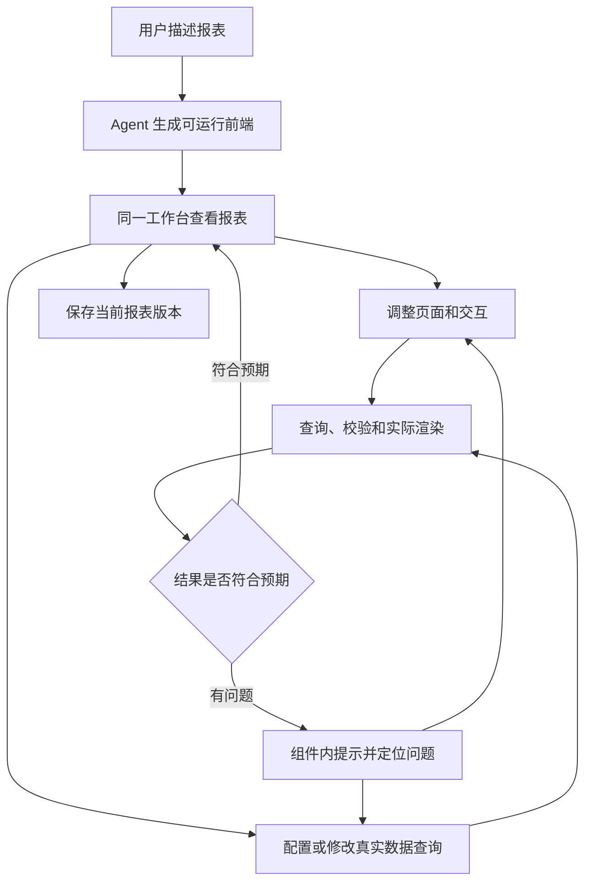

# AI 报表共创工作台—产品设计

> 更新日期：2026-10-22
> 范围：简单报表的生成、编辑、数据绑定和即时验证
> 文档状态：依据本轮讨论整理的当前产品规格；功能实现和验收执行另行记录

## 1. 产品定位与已确认决策

用户通过自然语言直接生成可运行的报表前端，在同一工作台不断调整页面、接入数据、查看结果、验证和修复，直到满意并保存。

1. **取消独立 S01 建设蓝图阶段。** 不要求先完成需求蓝图、低保真原型、蓝图确认或阶段移交。用户描述就是首版页面的起点。
2. **页面设计与数据对接共同推进。** 原 S02、S03 仅保留为历史能力编号，用户无需切换阶段，也无需等整页设计完成才接数据。
3. **首版直接生成真实可运行前端。** 图表、表格和筛选操作可以实际执行；数据来源逐组件确定。前端可运行不代表其中数据是真实数据。
4. **未接入真实数据的组件使用示例数据，并持续显示“示例数据”水印。** 同一页面可以同时包含示例组件、真实数据组件及错误组件。
5. **查询失败和前端渲染失败在对应组件内明确反馈。** Agent 能定位错误对象，继续修改并验证；其他组件继续工作。
6. **主要使用方式是边做边看。** 创建、设计、查询、修复和保存都在同一上下文完成，不再设置 S01→S02→S03 的串行门槛。
7. S04 验收发布、S05 资产管理、S06 AI 解读助手是下一阶段目标，需求尚待梳理，不加入本期交付条件。

## 2. 本期范围

主要服务于业务人员的简单报表，例如销售日报、经营概览、部门排名和趋势分析。默认先生成一页，按用户要求增加报表页或明细区。

| 本期必要能力 | 范围 |
| --- | --- |
| 自然语言创建与修改 | 根据用户描述生成、调整可运行页面；选中组件后精准修改 |
| 基础报表组件 | 指标卡、折线图、柱状图、饼图、表格、文本及常用筛选器 |
| 视觉与交互 | 标题、布局、颜色、单位；时间/条件筛选、刷新、表格排序和分页 |
| 数据查询与绑定 | 使用现有可授权的数据能力，匹配指标/维度，建立查询和字段映射 |
| 组件数据状态 | 示例水印、真实结果、加载、空结果、缺配置、查询失败和渲染失败 |
| 持续验证与修复 | 查询、字段校验、实际渲染、交互验证；组件定位和定向修复 |
| 保存与恢复 | 一起保存页面、查询定义、字段映射、筛选规则和数据模式；支持撤销与恢复 |

下钻、穿透、级联筛选、跨页跳转等按具体报表需要配置，只有真实接口和权限支持时才承诺可用；不要求简单报表默认具备完整多页应用的全部能力。多方案分支、蓝图对照、复杂交互编排器、独立发布审批及组织级资产治理不列入本期必做清单。

## 3. 用户主流程

没有真实数据源时，先展示带水印的示例页面；已有明确且可用的查询时，可在首版直接展示真实数据，无须人为经过示例模式。保存草稿不以全部组件接通真实数据为前提。

### 3.1 连续对话示例

| 用户表达 | 工作台行为 |
| --- | --- |
| “做一个销售日报，包含销售额、部门排名和每日趋势。” | 直接生成可运行页面，未接真实数据的组件显示“示例数据”水印 |
| “把销售额接到我们的销售收入指标，默认本月。” | 为指标卡查找授权指标，确认口径及时间参数，执行查询；查询和渲染成功后展示真实值 |
| “部门排名改成横向柱状图。” | 只改对应组件的展示方式，保留已存在的数据绑定和筛选规则 |
| “趋势图也接真实数据。” | 配置趋势查询与日期/数值字段映射，独立执行并验证 |
| “这个图怎么报错了，帮我修复。” | 根据选中组件的查询或渲染错误定位原因，修复后重新执行必要验证 |
| “加一个月份筛选，影响这三个组件。” | 新增筛选器并绑定目标查询，实际操作验证；其他组件不受影响 |
| “保存，先保留明细表的示例数据。” | 保存整个当前版本；明细表仍带水印，页面不被标记为全部真实数据已验证 |

### 3.2 需求理解融入生成过程

Agent 从对话中识别报表主题、组件、指标含义、时间范围和筛选条件，并在实际页面与配置中持续更新。可以记录简短的变更摘要和待确认问题，不再生成一份必须先审完的建设蓝图。

布局、颜色、图表类型等可逆选择可以先采用合理默认值，用户看到结果后调整。指标歧义、真实数据源不明或权限不足时，在对应组件旁说明问题并做必要澄清；其他组件仍可继续编辑。不得把猜测的指标编码或统计口径当成已确认配置。

## 4. 单一工作台布局与编辑规则

| 区域 | 内容与行为 |
| --- | --- |
| 顶部 | 报表名称、保存状态、撤销/恢复、预览入口；不显示 S01–S03 阶段进度 |
| 左侧对话 | 用户描述、Agent 操作反馈、选中组件上下文、必要问题及修复结果 |
| 中央页面 | 实际渲染的报表；选中、编辑和体验交互；逐组件展示数据状态和错误 |
| 按需属性/数据面板 | 当前组件的标题、样式、查询、字段映射、参数、结果摘要与错误详情 |

用户说“这个图”时，优先使用明确选中的组件；目标仍不明确时先定位或询问，不随意修改其他对象。页面和组件有稳定标识，对话操作、人工编辑、查询及错误都指向同一对象。

选择组件编辑与实际体验筛选/图表交互要有明确操作区分，避免选择动作意外触发下钻。属性和查询面板按需打开，页面始终是主要反馈区域；不设置强制蓝图视图或独立数据阶段画布。

Agent 的反馈应简短说明“改了什么、结果怎样、还有什么问题”。颜色、标题等局部修改及时应用且可撤销；删除组件、批量替换查询、改变业务口径等影响较大的操作，先展示对象及影响范围，再确认应用。

### 4.1 画布编辑态与预览态

右侧报表画布提供明确的“编辑 / 预览”模式切换，两个模式操作同一份报表状态：

| 模式 | 画布行为 |
| --- | --- |
| 编辑 | 显示编辑工具栏、缩放控制和组件选中边框；点击组件可选中并打开属性面板，标题、展示类型、颜色、单位及查询参数可直接修改，标题也可在画布内联编辑；在组件拖动把手上拖动可调整组件顺序，拖动右下角缩放把手可调整宽度和高度。用户可继续在左侧对话中要求 Agent 修改当前选中组件，未选中组件时默认作用于整张报表。 |
| 预览 | 隐藏选中边框、拖动及缩放手柄、画布缩放工具和编辑属性面板，并清除当前组件选中，呈现最终报表效果；筛选、图表联动、排序和分页等已配置的报表交互保持可用。 |

编辑态下对组件的选择不得误触发预览态的数据联动；组件布局及尺寸调整应即时反映在画布上，并与组件属性、查询绑定和 Agent 修改保持同步。缩放只改变编辑画布的查看比例，不改变报表组件实际尺寸。切换模式或保存草稿不应丢失布局和配置；草稿恢复后仍可继续编辑。该能力面向简单报表提供直接操作，不要求用户编写代码或操作复杂布局参数。

## 5. 前端生成与持续修改

- 直接生成可渲染、可操作的前端。筛选、排序、分页等已生成的操作应实际生效；不把静态截图或无行为按钮当成交付。
- 首版渐进显示已生成组件；生成失败时保留对应位置并提示，不清空已成功区域。
- 同一份当前报表状态用于编辑和预览。人工调整与 Agent 修改必须能相互读取，不用旧稿覆盖新改动。
- 标题、颜色、大小、布局等展示修改保留原查询、数据模式和字段映射；将折线图换成柱状图时尽量沿用兼容的数据配置。
- 新增指标、修改统计粒度或换成不兼容图表类型时，同步检查查询和字段映射；不兼容项在组件内明确提示并支持继续修复。
- 修改后只刷新和验证受影响对象。一个组件失败，不应阻止其他组件编辑、查询或查看。

## 6. 查询与数据绑定

### 6.1 单个组件接入流程

选中组件或通过自然语言指定 → 识别指标、维度、时间、单位 → 查找当前可授权来源 → 确定查询及字段映射 → 执行真实查询 → 校验结果结构 → 实际渲染 → 显示当前结果和验证状态。

这一过程可在任意设计时刻发生。可以先接指标卡、再改布局、再接趋势图，也可以先配置查询、再生成对应图表。绑定配置存在、查询成功、渲染成功、业务结果已核对分别记录；不能用其中一步成功替代后续步骤。

### 6.2 复用现有数据能力

沿用既有资料中的接入方向：复用 Mateclaw 问数、Aloudata Semantic/元数据和现有查询服务，RAG 可帮助理解业务术语及背景。具体服务、接口版本、可查询指标与维度，以当前部署和用户授权实际确认。

正式指标口径及编码需由可访问的权威元数据确认，RAG 文本和 Agent 推断仅辅助匹配。指标同名不同义时，向用户呈现差异并确认。接口不支持所需粒度、明细或级联时，保留可见缺口，支持改查询或调整页面要求；不编造接口和查询结果。

查询经可信后端执行，登录身份、租户和数据权限由服务端校验；前端和 Agent 对话不保存或展示连接凭据。页面筛选不能取消权限过滤，错误详情也应隐藏凭据及敏感数据。

### 6.3 查询与组件的最小关联信息

| 对象 | 记录内容 |
| --- | --- |
| 报表与组件 | 报表版本、组件标识、类型、展示配置、交互及数据输入要求 |
| 查询定义 | 数据源引用、正式指标/维度、时间和筛选规则、排序/分页、期望字段及类型、查询版本 |
| 数据绑定 | 组件输入与查询的关联、字段映射、单位转换、示例/真实模式 |
| 参数绑定 | 筛选器参数如何作用于哪些查询；默认值、必填条件、单选/多选及空值规则 |
| 最近执行 | 请求标识、查询/绑定版本、有效参数摘要、时间、状态、结果摘要及可用的追踪标识 |
| 验证记录 | 当前版本查询、字段、渲染、交互及业务核对的结果和问题 |

这些信息由工作台随编辑维护，不要求用户先填写复杂契约或手动完成阶段交接。

### 6.4 字段、参数与统计口径

- 为图表明确日期/类别、数值和系列字段，为表格明确列和类型；按映射适配返回结果，不按位置猜字段。
- 日期粒度、金额单位、百分比和空值处理明确且一致。类型不匹配时提示具体字段，不静默转成零值。
- 筛选选项区分展示名称与实际查询键；“未选择”“全部”“空集合”按配置处理，不混为同一种过滤。
- 需要候选项的筛选器可以使用已声明的静态选项或真实查询。使用模拟候选值时，筛选组件也显示“示例数据”水印；不得将未经校验的模拟键直接传给真实查询。
- 用户修改筛选条件时，把当前参数传给受影响查询。快速切换条件时，旧请求返回不得覆盖新条件的结果。
- 多个组件共享查询时，修改需提示受影响组件。删除单个组件不删除仍被其他组件使用的查询。
- 占比等展示计算保留分子、分母的指标与过滤范围。例如部门占公司收入比，分母可忽略部门业务筛选，但仍必须执行用户权限限制。

## 7. 组件级数据状态与水印

### 7.1 状态与页面表现

| 状态 | 对应组件的表现 | 可继续操作 |
| --- | --- | --- |
| 使用示例数据 | 实际展示模拟结果，组件内持续可见“示例数据”水印 | 改页面、体验交互、配置真实查询 |
| 正在配置真实查询 | 显示“数据配置中”；若继续展示先前示例画面，仍保留水印并注明尚未切换成功 | 完善查询、字段及参数 |
| 真实查询加载中 | 显示组件内加载状态，不用空白画面代替 | 其他组件继续使用 |
| 真实查询成功且渲染成功 | 展示真实结果，可查看来源、参数摘要和更新时间；移除示例水印 | 查看、筛选和核对结果 |
| 真实查询成功但无数据 | 显示“当前筛选条件下暂无数据”，保留标题和筛选上下文 | 调整条件、重新查询 |
| 缺少必要配置/参数 | 指明缺哪个指标、字段或必填条件 | 补充配置或请 Agent 修复 |
| 查询失败/超时/权限不足 | 在组件内显示对应错误，保留位置和标题 | 查看详情、重试、请 Agent 修复 |
| 结果校验或前端渲染失败 | 在组件内显示校验/渲染错误，说明可定位原因 | 查看详情、修复映射或前端配置 |
| 相关配置已修改 | 标记“待重新验证”，不得延用旧版本通过状态 | 重新查询或渲染受影响对象 |

组件的来源模式和当前运行状态分别管理。真实模式即使失败仍为真实模式错误，不自动改回示例模式。查询有真实结果但渲染失败时显示渲染错误，不显示成功图表，也不将其标成示例数据。

### 7.2 水印规则

1. 水印落实到使用示例数据的每个图表、指标卡、表格或筛选组件，明确写“示例数据”；不能只在页面顶部统一提示一次。
2. 水印随组件显示，在编辑、预览和恢复草稿后保持可见；不遮挡关键数据、错误信息及操作按钮。纯文本标题和装饰无需水印。
3. 一个组件依赖多个输入，只要实际展示结果仍混入模拟输入，就保留水印，并在详情说明哪些输入未接真实数据。
4. 只有当前显示内容全部来自真实查询且正常渲染时，才显示为真实结果并移除水印。真实空结果展示空状态；失败展示错误状态。
5. 显式切回示例预览时立即恢复水印，并保留真实查询配置供后续继续修复。不得因真实查询失败隐式回退示例数据。

### 7.3 旧结果与本次结果

本次请求失败时，默认用清晰的错误状态替代正常图表。若保留上一份成功结果供参考，必须同时在组件上显著标明“上次成功结果，当前查询失败”及其时间/筛选范围；旧结果不冒充本次成功。

查询参数、数据绑定或页面配置发生变化后，历史验证结果仅作为历史记录；报表恢复后若展示缓存结果，也必须注明数据时间和状态，真实数据最新性需通过重新查询确认。

## 8. 查询失败与前端渲染失败

### 8.1 在对应组件内反馈

查询和渲染错误均显示在发生问题的组件内部。保留组件标题、位置与足够的可见区域，让用户能指出“这个图”并继续交流。全局消息或对话反馈可补充，但不能代替组件本身的提示。组件级异常边界或等效机制应覆盖图表实际渲染及异步更新，避免单个组件异常导致整页白屏。

| 类型 | 示例提示 | 操作 |
| --- | --- | --- |
| 缺少必填条件 | 数据查询未执行：请先选择“统计月份” | 补充条件、请 Agent 修复 |
| 查询执行失败 | 数据查询失败：查询服务返回错误 | 重试、查看详情、请 Agent 修复 |
| 查询超时 | 数据查询超时，请重试或缩小时间范围 | 重试、调整条件 |
| 权限不足 | 暂无权限访问该数据源或指标 | 查看权限说明、选择可访问来源 |
| 返回字段不匹配 | 数据字段不匹配：缺少数值字段“销售额” | 修复字段映射、查看详情 |
| 前端渲染失败 | 图表渲染失败：日期字段格式不符合要求 | 重新渲染、查看详情、请 Agent 修复 |
| 未知渲染异常 | 图表暂时无法显示，请重试或让 AI 帮助修复 | 重新渲染、查看脱敏详情、请 Agent 修复 |

原因应基于实际可获得的错误信息；不知道具体原因时如实说明，不能编造“字段错误”等诊断。真实查询成功但无行数据属于空状态，不按失败处理；数值为零也不能误判为空。

### 8.2 错误信息与重试

用户首先看到简短原因和可执行动作。可展开的脱敏详情包含组件标识、错误发生环节、可定位字段、当前版本、有效参数摘要、发生时间及可用的请求/追踪编号；不直接暴露凭据或完整敏感响应。

查询重试使用当前有效查询和参数。渲染重试在已有结果仍与当前配置兼容时复用结果；查询、字段或参数已改变时，重新查询再渲染。重试中显示加载状态，结束后明确成功、空结果或仍失败，不能仅移除错误提示。

失败隔离的边界是受影响组件及其依赖。共享查询失败时，所有依赖组件都显示可理解的错误；无关组件继续工作。筛选候选项失败时在筛选器内显示，不静默改成“全部”或使用示例候选驱动真实查询。

### 8.3 Agent 定向修复

点击“请 Agent 修复”或选中错误组件发出自然语言指令时，工作台向 Agent 提供对应组件、当前前端配置、查询/绑定版本、有效参数摘要及脱敏错误上下文。

Agent 区分查询、权限、字段适配和渲染问题，按最小范围修改，然后重新执行受影响的查询、校验、渲染或交互。反馈说明实际修改与验证结果；权限不足或数据源不可用时保留错误并提示需要用户处理的事项，不能自行扩大权限或声称修复成功。自动修复不得无限循环，相同错误持续发生时说明尝试结果并等待新的输入。

## 9. 边做边验证

验证围绕当前组件和当前报表版本持续执行，不设置单独的 S03 准入或移交步骤。

| 修改内容 | 必要验证 |
| --- | --- |
| 标题、颜色、布局 | 实际渲染受影响组件，确认展示正确、原数据绑定仍在 |
| 查询、指标、时间或筛选规则 | 执行当前真实查询，核对字段与类型，再实际渲染 |
| 图表类型、字段映射或展示计算 | 检查输入兼容、单位与空值规则，实际渲染并核对结果 |
| 筛选器或组件联动 | 实际操作，核对有效参数、受影响组件和最终显示 |
| 错误修复 | 重现原问题，再用修正版本验证，不沿用历史通过结论 |

查询成功只说明本次执行成功。业务口径和结果合理性仍需核对，例如单位、日期范围、筛选范围、占比分子分母，以及图表是否遗漏数据。没有实际执行的检查标记为“未验证”，真实执行失败标记为“失败”，数据能力或权限不足标记为“阻塞”。

草稿始终可以保存，包括部分示例和失败组件。仅当本次约定要接真实数据的组件全部使用真实输入，查询、字段、渲染、约定交互和业务核对均通过，且相关版本未变化时，才可标记“本次范围已验证”；这不代表报表正式发布或通过后续独立验收。用户缩小本次范围时记录调整，不能把失败项自动移出统计。

## 10. 保存、撤销与恢复

保存同一报表版本时，页面布局、组件、查询定义、字段映射、参数规则及示例/真实模式一起保存。会话中的组件选择和错误定位引用稳定对象标识，恢复后可继续修改。

支持撤销本次变更并恢复相应配置；涉及共享查询时涵盖受影响绑定，避免只恢复页面而留下新查询。历史快照保留原版本，不被后续编辑覆盖。查询结果和验证记录注明来源版本及时间；恢复配置不等于重新获得最新数据或当下权限。

仅修改展示属性时保留绑定；修改指标或查询时将受影响验证标为过期，其他不相关组件的结果不被无故清空。保存失败时明确提示，不能显示“已保存”。

## 11. 本期验收场景

以下是待执行的产品验收场景，执行时记录实际结果、版本、证据及问题。本文件未声称这些场景已通过。

| 编号 | 场景 | 预期结果 |
| --- | --- | --- |
| AC-01 | 无蓝图直接描述销售日报 | 生成可运行页面，无 S01 确认或移交要求 |
| AC-02 | 首版组件尚无真实来源 | 每个示例数据组件都有可见“示例数据”水印 |
| AC-03 | 首版已有明确可用真实查询 | 可直接用真实结果渲染，无须先完成示例阶段 |
| AC-04 | 只为销售额卡片绑定真实查询 | 卡片显示真实结果并移除水印；其他示例图表仍带水印 |
| AC-05 | 接数据期间修改标题、颜色和布局 | 可持续编辑，既有绑定及其他组件状态保留 |
| AC-06 | 新增图表后立即配置查询 | 新组件独立查询、渲染，无整页设计完成门槛 |
| AC-07 | 同一组件部分输入为模拟数据 | 保留水印，并能查看未接真实来源的输入 |
| AC-08 | 真实查询仍在等待 | 对应组件显示加载状态，其他组件可继续操作 |
| AC-09 | 查询返回空行或数值零 | 空行展示空状态；数值零正常展示；均不回退示例 |
| AC-10 | 查询失败、超时、缺参数或权限不足 | 对应组件显示准确提示和处理入口，整页不白屏 |
| AC-11 | 查询成功但返回字段缺失或类型不符 | 显示可定位的字段校验错误，不伪造正常图表 |
| AC-12 | 初次渲染或异步更新发生前端异常 | 对应组件显示渲染错误；其他组件不被破坏 |
| AC-13 | 选中错误组件要求 Agent 修复 | Agent 获得该组件的错误上下文，定向修改并重新验证 |
| AC-14 | 点击重试或重新渲染 | 使用当前配置，显示过程及实际结果；仍失败时保留错误 |
| AC-15 | 快速切换月份，旧请求较晚返回 | 页面最终对应最新月份，旧响应不覆盖新结果 |
| AC-16 | 本次查询失败但保留历史结果 | 同时显著显示当前失败、旧数据时间及范围 |
| AC-17 | 真实模式失败后显式切回示例 | 恢复示例水印，保留真实配置；无隐式切换 |
| AC-18 | 增加日期筛选并影响多个组件 | 参数作用范围正确，筛选前后结果和组件状态一致 |
| AC-19 | 筛选候选来源为模拟或真实来源失败 | 模拟候选有水印；失败有错误；无效模拟键不驱动真实查询 |
| AC-20 | 更换共享查询或删除消费组件 | 提示影响范围，未删除仍被引用的查询，无关组件继续工作 |
| AC-21 | 保存含示例、真实和失败组件的草稿后恢复 | 配置及数据模式完整恢复，示例水印和验证时效正确 |
| AC-22 | 修改查询后查看此前验证结论 | 受影响对象标为待重新验证，不沿用旧通过状态 |
| AC-23 | 撤销同时影响页面与查询的修改 | 恢复一致的页面、绑定和查询版本 |
| AC-24 | 指标歧义、接口缺口或无权限 | 清晰说明并可继续做其他部分；无虚构指标、结果或修复成功 |
| AC-25 | 将当前报表范围标记为已验证 | 必要真实组件、查询、渲染、交互及业务核对均有当前版本证据 |
| AC-26 | 查看错误详情或发送修复上下文 | 能定位对象、环节与请求，且不泄露凭据和敏感内容 |
| AC-27 | 编辑态与预览态切换 | 编辑态显示组件选择及布局控制；预览态隐藏编辑控件，同时保留报表筛选和联动 |
| AC-28 | 直接操作画布布局 | 用户能拖动调整组件顺序、拖动边缘/角点调整尺寸，并即时看到结果；布局与属性、Agent 修改使用同一份状态 |
| AC-29 | 编辑态缩放及草稿恢复 | 缩放只改变画布查看比例；保存并恢复后组件布局、尺寸及配置保留，可继续编辑 |

## 12. 资料收敛与后续边界

旧 S01 的蓝图生成、蓝图确认、双视图对照和阶段移交要求退出当前产品范围。原 S02、S03 的页面生成、组件选择、局部修改、查询、参数映射、字段校验及可追溯能力合并到本文；旧阶段的全部 P0 与测试数量不再直接继承。

原 S01–S03 阶段式规格、原型及测试材料已从本目录删除。S00 旧流程演示尚未改成本文描述的产品体验。后续若实现新原型，应围绕单一工作台和组件状态验证；不能将旧原型表现视为本规格已实现。

S04–S06 资料仅保留为后续目标讨论，具体需求和接口需重新梳理。本期的保存、预览和“本次范围已验证”不引入发布审批、组织资产中心或业务 AI 解读助手。
