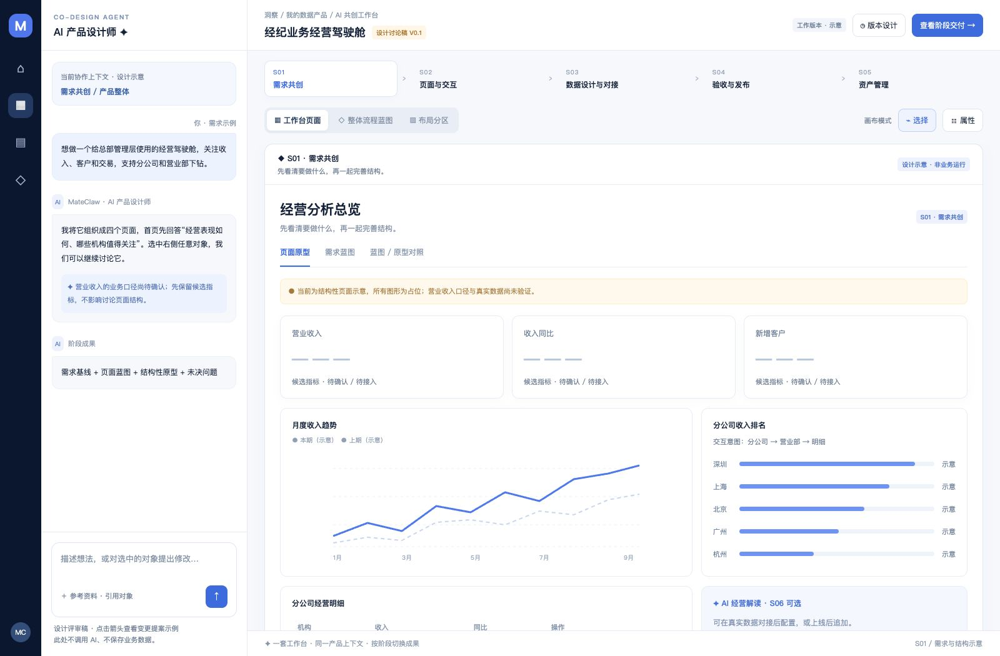
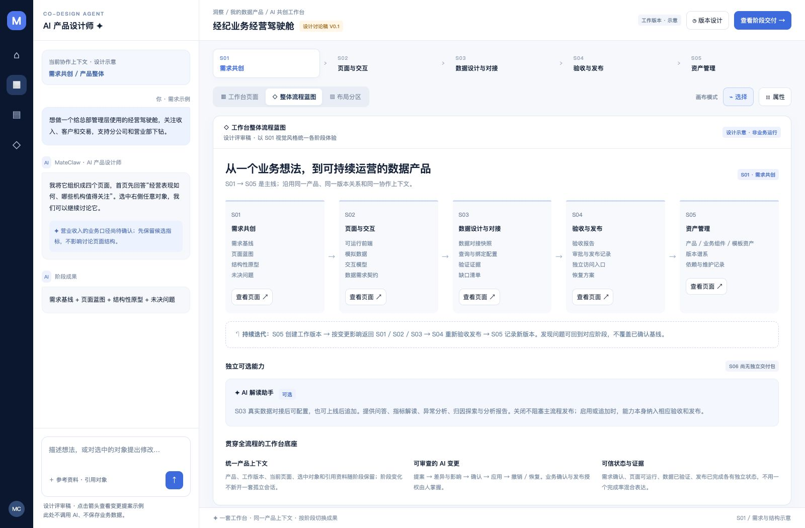
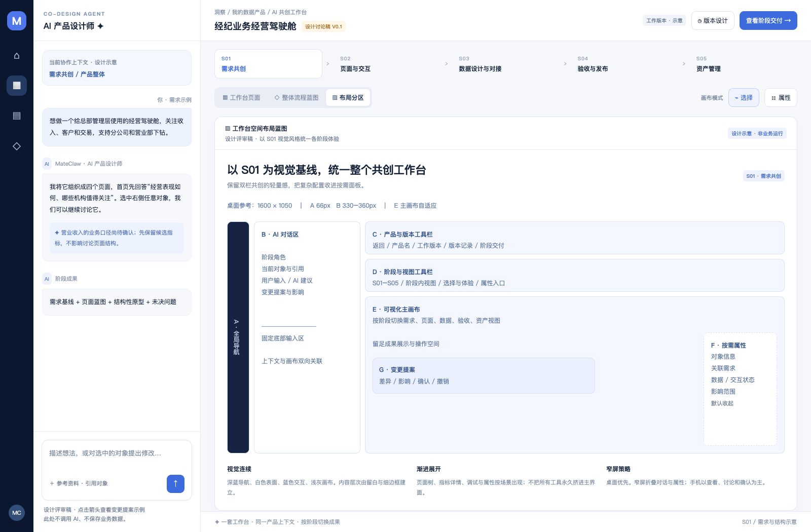
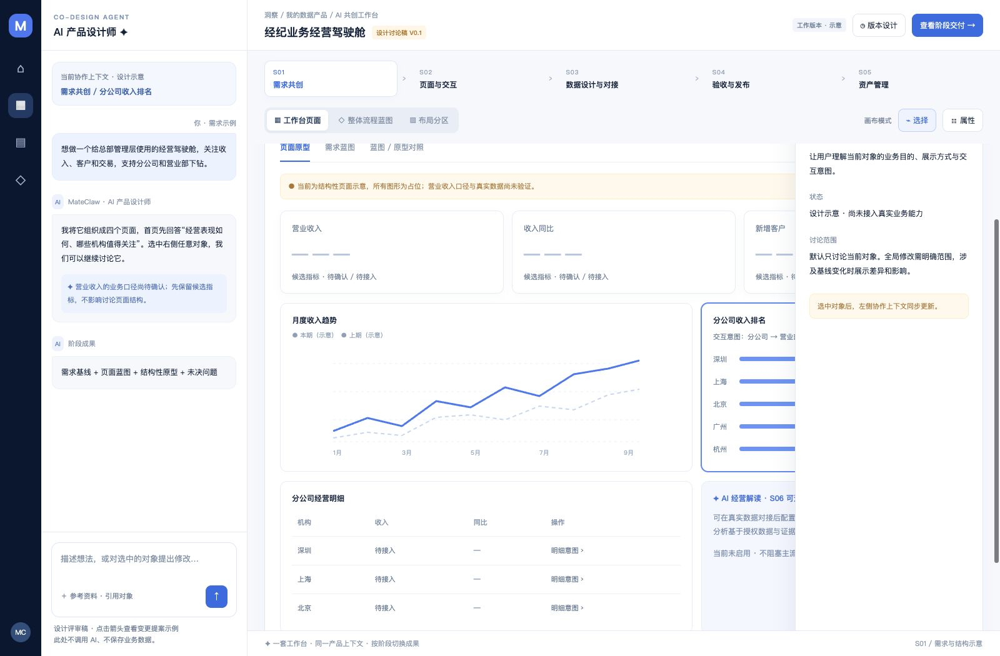

# AI 共创工作台 · 产品 HTML 原型 V0.2

日期：2026-10-22。状态：可运行的无后端前端原型，使用本地模拟数据。

本轮目标：以 S01 交付包的视觉与共创方式为基线，把已有各阶段设计串成一套可讨论的工作台，并将 S01/S02 经营分析页面做成可交互前端。接口由本地模拟替代，不调用模型、不接入业务数据、不执行生产发布。

## 直接查看

打开 [设计蓝图](./index.html)，无需安装依赖，可离线运行。

- **工作台页面**：切换 S01—S05，查看阶段角色、对象上下文、画布视图与交付说明。
- **整体流程蓝图**：查看阶段成果、持续迭代回路和独立可选的 S06。
- **布局分区**：查看导航、对话、版本工具、画布、属性及变更提案的位置。
- 点击 S01 的 KPI、趋势或排名对象，查看左侧上下文同步与右侧属性抽屉。
- 点击对话区箭头，查看变更提案示例；点击“查看阶段交付”，查看阶段条件。

## 无后端可交互原型

当前页面已扩展为可操作的前端产品原型，所有接口和数据均为本地模拟，不依赖后端或网络。刷新会恢复保存在浏览器本机的演示草稿；“重置筛选”可恢复默认数据范围。

- **经营数据**：按统计周期、机构范围筛选，KPI、趋势和排名同步更新；支持排名排序、分页及趋势图面积/折线切换。
- **逐级下钻**：从分公司进入营业部，再打开模拟经营明细；面包屑可返回上级，筛选和表格操作均可继续使用。
- **页面联动**：经营总览、收入、客户、交易分析页可切换；支持模拟交易详情和 CSV 导出。
- **AI 共创交互**：输入自然语言演示指令会生成带影响说明的提案；确认后应用，可撤销；取消会保留现状。演示规则基于关键词，不调用真实模型。
- **本地草稿**：页面、周期、机构、图表样式和主题保存在浏览器 localStorage，不会上传。

S01 需求共创与 S02 页面交互展示可运行的经营分析原型；S03—S05 保留阶段蓝图界面。本原型不包含真实模型、接口、鉴权、业务数据、多人协作或正式发布能力。

## 设计取向

主要用户是通过业务语言创建数据产品的业务人员与分析人员。视觉采用 S01 的深蓝窄导航、白色对话与内容表面、浅灰蓝画布背景、蓝色主操作、细边框和适量圆角。中文使用系统字体，减少阅读负担。无外部字体、在线组件或网络依赖。

本稿选择“统一工作台外壳 + 阶段工作区”的方案。它延续 S01 的双向共创方式，也让不同阶段共享产品和版本身份。纯线性向导不适合反复修改与回流；五个独立系统则容易割裂上下文和成果。因此阶段导航可返回查看，是否允许正式移交由各阶段条件决定，不能用“点过下一步”替代质量验证。

界面的主要特征是：左侧讨论对象，右侧看到成果；对象选中、AI 讨论范围与当前阶段始终关联。属性和复杂配置按需出现，画布保留主要空间。

## 一套外壳，五种阶段画布

| 阶段 | AI 协作角色 | 主要画布 | 阶段成果 |
| --- | --- | --- | --- |
| S01 需求共创 | 产品设计师 | 结构原型、需求蓝图、需求与原型映射 | 需求基线、页面蓝图、结构原型、未决问题 |
| S02 页面与交互设计 | 页面设计师 | 页面设计、交互关系、运行与调试 | 可运行前端、模拟数据、完整交互、数据契约 |
| S03 数据设计与对接 | 数据设计师 | 数据需求、查询与绑定、验证与移交 | 真实数据候选产品、配置快照、验证证据 |
| S04 验收与发布 | 验收助手 | 验收总览、问题与回归、发布门禁 | 验收报告、审批发布记录、独立入口、恢复方案 |
| S05 资产管理 | 资产助手 | 资产中心、版本与依赖、维护与治理 | 产品、业务组件、模板资产及长期版本谱系 |

表中描述正式产品的目标能力。本地原型实现了 S02 经营页面的筛选、图表、下钻、详情和导出交互；阶段移交、运行调试流程及其他正式产品能力仍是界面蓝图。

**S06 独立可选**：在 S03 真实数据对接完成后配置，或上线后追加。不启用不阻塞 S04；启用时纳入相应验收范围。上线后追加仍需增量验收与发布。S06 的业务解读与共创工作台的阶段 AI 协作角色分别呈现。

**持续迭代**：S05 创建工作版本 → 按影响返回 S01/S02/S03 → S04 重新验收发布 → S05 记录版本。正式版本不原地覆盖。标签、负责人等管理属性与产品内容变更分别处理。

## 空间与导航

| 分区 | 桌面参考规格 | 职责 |
| --- | --- | --- |
| A 全局导航 | 66px | 产品入口、共创、资产及全局路径；本稿入口仅做导航设计示意 |
| B AI 对话区 | 330–360px | 当前阶段角色、当前选中对象、引用、建议与固定底部输入区 |
| C 产品与版本栏 | 约 81px 高 | 产品名、返回路径、工作版本、版本设计、阶段交付 |
| D 阶段与视图工具栏 | 根据宽度排列 | S01—S05 导航，阶段视图、选择/体验与属性入口 |
| E 可视化画布 | 自适应剩余空间 | 当前阶段主要成果；与对话独立滚动 |
| F 属性抽屉 | 300px，默认关闭 | 对象属性、关联需求与状态；讨论结束可关闭 |
| G 变更提案 | 按需弹层或局部区域 | 变更、差异、影响、确认、撤销；本稿以弹层示例表达 |

设计基准为 1600 × 1050。1000px 以下折叠对话，通过“AI 对话”打开；650px 以下改为单列内容与换行导航。手机以查看、讨论与确认为主，不把桌面编辑能力压缩到手机上。

当前原型在本机浏览器保存周期、机构、趋势样式、页面增删和主题；切换阶段回到阶段默认视图。正式产品还应持久化阶段成果、对象选择、版本关系、对话与引用链，并在对象失效时说明原因，不应把某阶段不兼容的临时选择强行传到下一阶段。

## 关键交互规则

1. **先有成果再讨论**：对话澄清伴随蓝图、页面或配置的增量变化。
2. **明确修改范围**：选中对象同步 AI 上下文；明确指令优先于临时选择，局部修改不隐含全局重做。
3. **选择与体验分开**：选择用于编辑对象；体验才执行业务交互。S01 未实现行为标明演示，正式 S02 需完成真实可运行的模拟交互。
4. **变更可审查**：提案 → 差异与影响 → 确认 → 应用 → 撤销/恢复。重大变更与已确认要求不能被 AI 静默覆盖。
5. **状态分别呈现**：需求确认、页面可运行、数据验证、验收和发布各自记录，不能混成一个“完成率”。
6. **质量条件与导航分开**：允许回看其他阶段，不等于通过其移交门禁。
7. **证据对应版本**：验收、审批与发布指向明确候选版本；修改后检查影响并重新验证。
8. **复用与授权分开**：复制、固定引用、模板实例化不复制实际数据权限。

## 对既有资料的统一处理

- S01 的视觉及双栏共创模式作为本稿风格来源。
- S01 早期文档仍存在 S04“交互”、S05“解读”、S06“发布”、S07“资产”的旧编号。本稿按目录入口及 S02—S05 的新定义统一为五阶段主线与可选 S06；未修改原始交付包。
- S02 已有可运行交互职责，S03 接数据而不重建页面行为，S04 验证而不承担页面开发。
- S05 的草稿资产可按协作权限发现；正式版本与工作版本分离。“未发布”不等于所有草稿不能进入资产目录。
- S06 当前没有独立设计包；本稿只保留边界和位置，不扩写完整功能规格。

## 参考来源

- [目录与新六阶段边界](../index.md)
- [S01 交付包](../S01-AI产品需求共创-交付包/README.md)：完整设计的第 4—7、9—10、19—20 章及原型/预览图。
- [S02 产品规格](../S02-页面与交互设计-v2.0/S02-AI页面与交互设计-v2.0.md)：阶段职责、完整模拟交互与数据需求契约。
- S03 交付包内《S03-AI数据设计与对接-v1.0.md》：第 1—6 章的阶段边界、复用与数据契约。
- [S04 验收与发布](../S04-验收与发布/S04-验收与发布-v1.0.md)：候选基线、真实证据、门禁与恢复。
- [S05 资产管理](../S05-数据产品资产管理-v2.0/S05-数据产品资产管理-详细产品设计与页面蓝图-v2.0.md)：资产类型、版本、复用和第 13 章空间布局。

## 评审关注点

本稿建议先确认三件事：S01 风格是否延续到位；统一工作台和阶段画布是否符合操作心智；阶段交付和变更回流是否清楚。确认后再细化各阶段页面树、完整状态、控件行为和开发规格。

## 实际预览

以下为 Codex 内部浏览器实际渲染截图，不是 AI 生成图片。

浏览器走查范围与结果见 [验证记录](./验证记录.md)。记录区分本地模拟前端的交互验证与仍未实现的后端、模型及正式产品能力。
